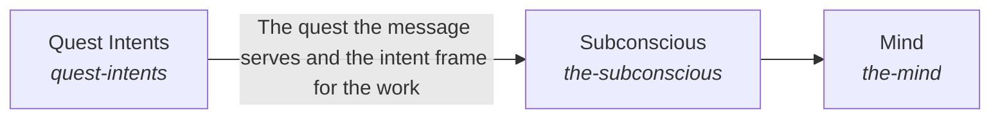

These are ESOI records rendered as a diagram (evolvable structure that optimizes intent). This page is generated from the solutions' outputs and the implementations' `uses_solution_ids` by `esoi diagram`; edit those records, not this page.

# Solution diagram: Intelligence

Intelligence turns one request into a response. Quest Intents says which of the person's quests the request serves. Subconscious finds the cards the request needs before it is asked for, from Card Store and Cards From Files, and Context Retriever picks among them. Mind plans the request in steps, through Planner and Context Intake, and Quest Work Shown tells the person what is happening. Critical Thinking holds the work to a measure through Metric Translation, Goal Completion and Response Quality, and Quest Autopilot starts standing work only when the person allows it.

An arrow runs from the solution that provides to the solution that builds on it; its label is what the provider outputs.

