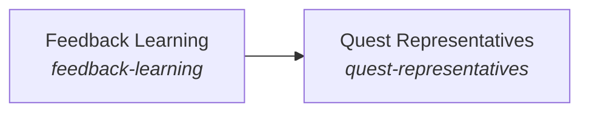

# Quest Intents

The AI works from the person's quests.

*ESOI records of this intent (evolvable structure that optimizes intent), generated from the CSV files beside this page by `esoi readmes`. Edit the CSV files, not this page.*

This sub-intent arises as the implementation `quest-intents:separate_stores` of its parent intent [`the_intelligence`](../../README.md). Opportunities: A representative works across many quests, so the standing view it needs is wider than any one request: past conversations, recent context, the guidance learned from corrections, the ledger of what was asked, the predictions made and the person's long-term goal. That opens questions the parent solution does not ask: how a correction is kept in the person's own words and tracked until it is followed, how a view is held per quest, per intent and per representative without crossing scopes, how a reply is aimed at the person's end without hijacking a simple question, and which representative a request runs as, the same way in chat, tasks and background work.

## How the solutions fit together

Quest Intents keeps the person's quests and intents as the standing view every request is read against. Intuition remembers what it expected to happen so a surprise can be noticed. Long-Term Memory keeps what was said across conversations and says what bears on the request. Feedback Learning keeps what the person corrected so it guides the next answer. Quest Representatives chooses, from that view, the representative that holds each quest.

## Diagram

An arrow runs from the solution that provides to the solution that builds on it; its label is what the provider outputs.

## Solutions at a glance

| Solution | Handle | Entry call | Selected implementation | Metric |
|---|---|---|---|---|
| Intuition | `the-intuition` | `quest_ai_runner.run("the-intuition", 'quest-id')` | Atomic file prediction store (`file`) | Prediction store contract pass rate |
| Long-Term Memory | `long-term-memory` | `quest_ai_runner.run("long-term-memory", ...)` | Local session-file conversation store (`session_file`) | Past-conversation recall and isolation over synthetic cases, Warm-start accuracy with no cross-work-item leakage |
| Feedback Learning | `feedback-learning` | `quest_ai_runner.run("feedback-learning", 'quest-id')` | File-backed feedback ledger (`ledger`) | Repeat-correction recall and precision over feedback sequences, Correction carry-through over the feedback-loop cases |
| Quest Representatives | `quest-representatives` | `quest_ai_runner.run("quest-representatives", {'assignee_rep_id': 'rep-1'})` | Persona resolver precedence for queued tasks (today) (`persona_resolver_precedence`) | Hand-offs a person keeps per unit of cost and time, Representative choice accuracy and thread consistency |

## Solutions from a library

- [Intuition](https://github.com/SpiritualData/ai-hub-of-hubs-structure/hubofhubs/the_intelligence/subconscious/README.md) (`the-intuition`): What comes to mind for a request without being asked for: cards and facts the Subconscious offers because they are close to the request, which the Mind may take or ignore. Adopted from the library `hub`.
- [Long-Term Memory](https://github.com/SpiritualData/ai-hub-of-hubs-structure/hubofhubs/the_intelligence/higher_mind/README.md) (`long-term-memory`): The retention policy and the recall over the Body's store: what the system keeps across requests, for how long, and how it is found again. Adopted from the library `hub`.
- [Feedback Learning](https://github.com/SpiritualData/ai-hub-of-hubs-structure/hubofhubs/the_consciousness/README.md) (`feedback-learning`): Applies a person's feedback to the specs and metrics, not to the instructions of every task, so a correction given once is followed afterwards. Adopted from the library `hub`.
- [Representatives](https://github.com/SpiritualData/ai-hub-of-hubs-structure/hubofhubs/the_consciousness/README.md) (`quest-representatives`): The AI personas that act for a person or a team. Specializes the library `hub`.

## Problems and ideals

**Problems**

- Private Data Crossing Scope (`prob-private-data-crosses-scope`): Data from one user, team or quest reaches another one's prompt or store, through retrieval, caches, conversation recall, shared stores or the sources fed to the AI.
- Wrong Or Inconsistent Representative (`prob-wrong-or-inconsistent-rep`): Which AI representative handles a message, a queued task, a newly assigned goal or an autopilot pass is decided in several places by different rules, with no shared definition of the right representative, no labelled measure of how often it is right, and no rule that work spawned from a thread keeps that thread's representative.
- Long-Term Goal Goes Quiet (`prob-long-term-goal-goes-quiet`): The AI answers the request in front of it and lets the person's long-term goal go quiet, so each small task is done without the end in sight; a pointer to the goal in every reply nags, hijacks a simple question or lands on a person who is in a hurry or upset.

**Ideals**

- Contained Scope (`ideal-contained-scope`): Data stays inside the user, team and quest it belongs to, on every read and write path.
- Moves Me Forward Without Nagging (`ideal-moves-me-forward`): From the call: every reply answers what was asked first and, at a natural moment, keeps the person's next milestone in view, at the intent level they are working at.

## Metrics and their leaders

- Past-conversation recall and isolation over synthetic cases (`metric-remember-conversations`): leader `session_files`, 9 of 10 cases
- Repeat-correction recall and precision over feedback sequences (`metric-guide-by-feedback`): leader `ledger_guidance`, 12 of 16 cases
- Correction carry-through over the feedback-loop cases (`metric-store-feedback`): leader `ledger_guidance`, 12 of 16 cases
- Warm-start accuracy with no cross-work-item leakage (`metric-recall-recent-context`): leader `file_store_filter`, 9 of 10 cases
- Prediction store contract pass rate (`metric-persist-predictions`): leader `file_store`, 12 of 12 cases
- Representative choice accuracy and thread consistency (`metric-select-a-rep`): leader `persona_resolver_precedence`, 14 of 16 cases
- Two-sided long-term guidance (`metric-guide-toward-the-long-term-goal`): leader `guided_v2`, 9 of 10 cases

## Where to go next

- Parent intent: [Intelligence](../../README.md)
- Repository: [top README](../../../../README.md)
- Records: [intent.csv](intent.csv), [problems.csv](problems.csv), [ideals.csv](ideals.csv), [solutions.csv](solutions.csv), [implementations.csv](implementations.csv), [metrics.csv](metrics.csv)
- Diagram page: [diagram.md](diagram.md)

---

## The full record

### Problems

- Private Data Crossing Scope (`prob-private-data-crosses-scope`): Data from one user, team or quest reaches another one's prompt or store, through retrieval, caches, conversation recall, shared stores or the sources fed to the AI.
- Wrong Or Inconsistent Representative (`prob-wrong-or-inconsistent-rep`): Which AI representative handles a message, a queued task, a newly assigned goal or an autopilot pass is decided in several places by different rules, with no shared definition of the right representative, no labelled measure of how often it is right, and no rule that work spawned from a thread keeps that thread's representative.
- Long-Term Goal Goes Quiet (`prob-long-term-goal-goes-quiet`): The AI answers the request in front of it and lets the person's long-term goal go quiet, so each small task is done without the end in sight; a pointer to the goal in every reply nags, hijacks a simple question or lands on a person who is in a hurry or upset.

### Ideals

- Contained Scope (`ideal-contained-scope`): Data stays inside the user, team and quest it belongs to, on every read and write path.
- Moves Me Forward Without Nagging (`ideal-moves-me-forward`): From the call: every reply answers what was asked first and, at a natural moment, keeps the person's next milestone in view, at the intent level they are working at.

### Solutions

| Solution | Handle | Selected | Metric |
|---|---|---|---|
| Intuition | `the-intuition` | Atomic file prediction store (`file`) | Prediction store contract pass rate |
| Long-Term Memory | `long-term-memory` | Local session-file conversation store (`session_file`) | Past-conversation recall and isolation over synthetic cases, Warm-start accuracy with no cross-work-item leakage |
| Feedback Learning | `feedback-learning` | File-backed feedback ledger (`ledger`) | Repeat-correction recall and precision over feedback sequences, Correction carry-through over the feedback-loop cases |
| Quest Representatives | `quest-representatives` | Persona resolver precedence for queued tasks (today) (`persona_resolver_precedence`) | Hand-offs a person keeps per unit of cost and time, Representative choice accuracy and thread consistency |

### Implementations

| Implementation | Handle | Where | Sub-intent |
|---|---|---|---|
| Local session-file conversation store | `long-term-memory:session_file` | [quest_ai_runner/the_intelligence/higher_mind/long_term_memory/session_file_conversation_store.py](../long_term_memory/session_file_conversation_store.py) |  |
| Universal guidance provider | `feedback-learning:universal` | [quest_ai_runner/the_intelligence/higher_mind/guidance/guidance_card_manager.py](../guidance/guidance_card_manager.py) |  |
| Live ledger and provider arm | `feedback-learning:ledger_guidance` | [evaluation/components/feedback_loop/impls/ledger_guidance.py](../../../../evaluation/components/feedback_loop/impls/ledger_guidance.py) |  |
| No-feedback floor | `feedback-learning:no_memory` | [evaluation/components/feedback_loop/impls/no_memory.py](../../../../evaluation/components/feedback_loop/impls/no_memory.py) |  |
| Show-everything baseline | `feedback-learning:dump_all` | [evaluation/components/feedback_loop/impls/dump_all.py](../../../../evaluation/components/feedback_loop/impls/dump_all.py) |  |
| File-backed feedback ledger | `feedback-learning:ledger` | [quest_ai_runner/the_consciousness/feedback_learning/feedback_ledger.py](../../../the_consciousness/feedback_learning/feedback_ledger.py) |  |
| Lexical-gated scoped file store | `long-term-memory:file` | [quest_ai_runner/the_intelligence/higher_mind/long_term_memory/recent_context.py](../long_term_memory/recent_context.py) |  |
| Atomic file prediction store | `the-intuition:file` | [quest_ai_runner/the_intelligence/subconscious/intuition/anticipation_store.py](../../subconscious/intuition/anticipation_store.py) |  |
| In-memory reference store | `the-intuition:memory_store` | [evaluation/components/persist_predictions/impls/memory_store.py](../../../../evaluation/components/persist_predictions/impls/memory_store.py) |  |
| Persona resolver precedence for queued tasks (today) | `quest-representatives:persona_resolver_precedence` | [quest_ai_runner/the_consciousness/representatives/personas.py](../../../the_consciousness/representatives/personas.py) |  |
| Host chat classifier among assigned representatives (today, in the host) | `quest-representatives:host_assigned_classifier` |  |  |
| A thread keeps its representative (proposed) | `quest-representatives:thread_holds_its_rep` |  |  |
| Fit by role, assigned quests and intent branch (proposed) | `quest-representatives:fit_by_role_and_quests` |  |  |
| Ask the person on an equal fit (proposed) | `quest-representatives:ask_the_person` |  |  |
| Reply voice before the long-term guidance section (prior) | `guidance:reply_voice` |  |  |
| Reply voice plus a long-term guidance directive (proposed) | `guidance:guided` |  |  |
| Plain answer only (floor) | `guidance:no_nudge` |  |  |
| Long-term guidance section in the reply voice | `guidance:guided_v2` | [quest_ai_runner/the_self/integrity/prompts/auxiliary_prompts.py](../../../the_self/integrity/prompts/auxiliary_prompts.py) |  |

### Metrics

- Past-conversation recall and isolation over synthetic cases (`metric-remember-conversations`): `esoi run conversation_recall --impl session_files`
- Repeat-correction recall and precision over feedback sequences (`metric-guide-by-feedback`): `esoi run feedback_loop --impl ledger_guidance`
- Correction carry-through over the feedback-loop cases (`metric-store-feedback`): `esoi run feedback_loop --impl ledger_guidance`
- Warm-start accuracy with no cross-work-item leakage (`metric-recall-recent-context`): `esoi run recent_context --impl file_store_filter`
- Prediction store contract pass rate (`metric-persist-predictions`): `esoi run persist_predictions --impl file_store`
- Representative choice accuracy and thread consistency (`metric-select-a-rep`): `esoi run select_a_rep --impl persona_resolver_precedence`
- Two-sided long-term guidance (`metric-guide-toward-the-long-term-goal`): `esoi run proactive_guidance --impl guided_v2`
