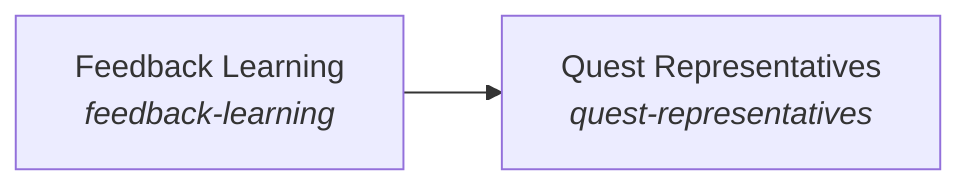

These are ESOI records rendered as a diagram (evolvable structure that optimizes intent). This page is generated from the solutions' outputs and the implementations' `uses_solution_ids` by `esoi diagram`; edit those records, not this page.

# Solution diagram: Quest Intents

Quest Intents keeps the person's quests and intents as the standing view every request is read against. Intuition remembers what it expected to happen so a surprise can be noticed. Long-Term Memory keeps what was said across conversations and says what bears on the request. Feedback Learning keeps what the person corrected so it guides the next answer. Quest Representatives chooses, from that view, the representative that holds each quest.

An arrow runs from the solution that provides to the solution that builds on it; its label is what the provider outputs.

