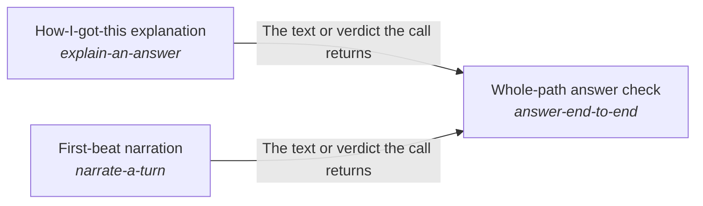

# Mind

Every request is answered from everything its work has established so far, in the best way possible.

*ESOI records of this intent (evolvable structure that optimizes intent), generated from the CSV files beside this page by `esoi readmes`. Edit the CSV files, not this page.*

This sub-intent arises as the implementation `the-mind:rebuilt_per_step` of its parent intent [`quest-ai-runner`](../../../esoi/README.md). Opportunities: The loop's prompt can be rebuilt for each step from a template, cached head and context layers, the newest observations in full and older ones in one line, so a step's input stays small while the final answer still sees everything. That opens questions the parent solution does not ask: how much of the earlier steps a planner must see to keep continuity (from the second step the selected arm replaces the transcript with a short note that refers to step one, and its continuity is unmeasured), how a person is kept informed while a turn works (a first line, interim replies, the trail of what was done) without paying a model call for every line, and how a request that worked before skips the loop by replaying its known steps.

## How the solutions fit together

Mind lets one step of a request build on the steps before it, and its rebuilt_per_step arm is made of the parts of one step. Budgeted prompt assembler writes the prompt a step sends within a size budget. Cost-ordered model tier selector with outage and allowance recovery picks the model tier a step starts on. Grounded chat turn handler turns the step's decision into the reply to a chat message. First-beat narration writes the first line a person reads while the turn works. How-I-got-this explanation writes, when the person asks for it, how the answer was reached, once the answer is out. Learned-operation fast path answers a request that worked before by replaying its known steps. Core ML tasks classifies the message a step is about. Whole-path answer check proves that a message is handled right across the whole path, with the first line that First-beat narration writes in it. It also proves the account of how the answer was reached, which How-I-got-this explanation writes on request. Reply in steps when the goal is not met yet decides when a turn that is not finished sends an interim message and what that message holds. Show the AI's work and next steps lays out the trail of the work a turn did. Mode-aware progress surfacing streams each event at the level the person wants.

## Diagram

An arrow runs from the solution that provides to the solution that builds on it; its label is what the provider outputs.

## Solutions at a glance

| Solution | Handle | Entry call | Selected implementation | Metric |
|---|---|---|---|---|
| Grounded chat turn handler | `answer-a-turn` | `quest_ai_runner.run("answer-a-turn", 'What should I work on first this week?')` | One turn of the orchestrator over the model (`orchestrator_turn`) | Judge pass rate over the chat quality cases |
| Mode-aware progress surfacing | `show-progress` | no entry declared | Stream, milestone and fan-out sinks (`stream`) | Surfaced-event policy by mode, Progress shown while the work runs |
| Learned-operation fast path | `replay-known-operations` | `quest_ai_runner.run("replay-known-operations", 'Add a note that the launch moves to Friday')` | The recipe store of the loop (`stored_recipes`) | Fast-path hit rate and parity with the planner-only path |
| Budgeted prompt assembler | `assemble-a-prompt` | `quest_ai_runner.run("assemble-a-prompt", 'What should I work on first this week?')` | The planner prompt written by the real loop (`planner_prompt`) | Prompt size against budget and duplicated-block count |
| Core ML tasks | `core-ml-tasks` | `quest_ai_runner.run("core-ml-tasks", 'Save a note that the launch moves to Friday.')` | The route as the classification label (`router_labels`) | Accuracy of core ML tasks over labelled cases |
| How-I-got-this explanation | `explain-an-answer` | no entry declared | One model call writes the explanation from the trace (today) (`model_explanation`) | Faithful explanations per unit of cost and time |
| Whole-path answer check | `answer-end-to-end` | `quest_ai_runner.run("answer-end-to-end", 'What should I work on first this week?')` | The shipped path as one call (`shipped_path`) | Whole-path turns right on a small mixed set, Day-with-Jarvis turns right end to end, Asks filed and deletes held before anything outward or irreversible happens, Replies that claim only what was done, Quest answers that name the person's goal and circumstance and fit features to them |
| Show the AI's work and next steps | `show-the-ais-work` | `quest_ai_runner.run("show-the-ais-work")` | The Trail (live line, one summary line, expandable groups) (`trail`) | What is shown of the AI's work is true, the same for everyone, and earns its place |
| Reply in steps when the goal is not met yet | `reply-in-steps` | `quest_ai_runner.run("reply-in-steps")` | The structural gate of core/interim_policy.py (`gated`) | Interim messages and asks that are true, not repeated and only where a person is needed |
| First-beat narration | `narrate-a-turn` | no entry declared | One cheap model call per turn writes the beat (today) (`model_beat`) | Supported first beats within the time and cost the turn allows |

## Problems and ideals

**Problems**

- Unreadable Work (`prob-progress-unreadable`): A person cannot see what their AI is doing for them: whether background work is moving, or what an answer rests on.
- Answers Not Tied To The Person's Goal (`prob-quest-answer-not-tied-to-my-goal`): Asked how Quest could help, what a feature is for, or whether it is worth it, Quest AI can answer with a list of everything Quest has, or with a generic description, instead of the few features that fit this person's goal and circumstance, or it can assume a circumstance the person did not give.
- Parts Pass While The Assistant Fails (`prob-assistant-not-jarvis-from-the-users-seat`): Each part of QAR can pass its own test while the assistant, as a person meets it across a day, forgets what it knows, acts unasked, claims work it did not do, or answers a vague request with a generic plan, and the person is the one who finds out.

**Ideals**

- Legible Work (`ideal-legible-progress`): A person can see what their AI is doing for them and what an answer rests on, as much as they need and no more, for the mode they are in.
- Goal-Fitted Answer (`ideal-quest-answer-fits-my-goal`): When a person asks what Quest can do for them, the answer picks the few features that fit their own goal and circumstance and says why each helps, instead of listing everything.
- Capable From The User's Seat (`ideal-jarvis-from-the-users-seat`): The assistant is judged as the person meets it across a day: one capable assistant that gets real work done in the person's own quests, asks before it does anything outward or hard to undo, and says only what it did.
- Present And Prompt (`ideal-jarvis-j01-always-there-and-fast`): The assistant answers whenever the person asks, and quickly enough that asking it is easier than doing the thing alone.

## Metrics and their leaders

- Judge pass rate over the chat quality cases (`metric-answer-a-turn`): leader `reference_replies`, 331 of 331 cases
- Surfaced-event policy by mode (`metric-show-progress`): leader `progress_sinks`, 14 of 14 cases
- Fast-path hit rate and parity with the planner-only path (`metric-replay-known-operations`): leader `planner_only_offline`, 30 of 30 cases
- Prompt size against budget and duplicated-block count (`metric-assemble-a-prompt`): leader `live`, 28 of 29 cases
- Accuracy of core ML tasks over labelled cases (`metric-core-ml-tasks`): leader `labelled_rows`, 3 of 11 cases
- Faithful explanations per unit of cost and time (`metric-explain-an-answer`): leader `model_explanation`, 9 of 10 cases
- Whole-path turns right on a small mixed set (`metric-answer-end-to-end`): leader `reference_script`, 13 of 13 cases
- Quest answers that name the person's goal and circumstance and fit features to them (`metric-quest-answer-tied-to-goal-and-circumstance`): leader `reference_script`, 13 of 13 cases
- Day-with-Jarvis turns right end to end (`metric-jarvis-ness`): leader `reference_script`, 13 of 13 cases
- Asks filed and deletes held before anything outward or irreversible happens (`metric-jarvis-floor-consent`): leader `reference_script`, 13 of 13 cases
- and 6 more: all 16 are in [metrics](#metrics) of the full record below

## Where to go next

- Parent intent: [Grounded AI that advances people's goals](../../../esoi/README.md)
- Repository: [top README](../../../README.md)
- Records beside the code: [quest_ai_runner/the_intelligence/mind/response_writer](response_writer/README.md)
- Records: [intent.csv](intent.csv), [problems.csv](problems.csv), [ideals.csv](ideals.csv), [solutions.csv](solutions.csv), [implementations.csv](implementations.csv), [metrics.csv](metrics.csv)
- Diagram page: [diagram.md](diagram.md)

---

## The full record

### Problems

- Unreadable Work (`prob-progress-unreadable`): A person cannot see what their AI is doing for them: whether background work is moving, or what an answer rests on.
- Answers Not Tied To The Person's Goal (`prob-quest-answer-not-tied-to-my-goal`): Asked how Quest could help, what a feature is for, or whether it is worth it, Quest AI can answer with a list of everything Quest has, or with a generic description, instead of the few features that fit this person's goal and circumstance, or it can assume a circumstance the person did not give.
- Parts Pass While The Assistant Fails (`prob-assistant-not-jarvis-from-the-users-seat`): Each part of QAR can pass its own test while the assistant, as a person meets it across a day, forgets what it knows, acts unasked, claims work it did not do, or answers a vague request with a generic plan, and the person is the one who finds out.

### Ideals

- Legible Work (`ideal-legible-progress`): A person can see what their AI is doing for them and what an answer rests on, as much as they need and no more, for the mode they are in.
- Goal-Fitted Answer (`ideal-quest-answer-fits-my-goal`): When a person asks what Quest can do for them, the answer picks the few features that fit their own goal and circumstance and says why each helps, instead of listing everything.
- Capable From The User's Seat (`ideal-jarvis-from-the-users-seat`): The assistant is judged as the person meets it across a day: one capable assistant that gets real work done in the person's own quests, asks before it does anything outward or hard to undo, and says only what it did.
- Present And Prompt (`ideal-jarvis-j01-always-there-and-fast`): The assistant answers whenever the person asks, and quickly enough that asking it is easier than doing the thing alone.

### Solutions

| Solution | Handle | Selected | Metric |
|---|---|---|---|
| Grounded chat turn handler | `answer-a-turn` | One turn of the orchestrator over the model (`orchestrator_turn`) | Judge pass rate over the chat quality cases |
| Mode-aware progress surfacing | `show-progress` | Stream, milestone and fan-out sinks (`stream`) | Surfaced-event policy by mode, Progress shown while the work runs |
| Learned-operation fast path | `replay-known-operations` | The recipe store of the loop (`stored_recipes`) | Fast-path hit rate and parity with the planner-only path |
| Budgeted prompt assembler | `assemble-a-prompt` | The planner prompt written by the real loop (`planner_prompt`) | Prompt size against budget and duplicated-block count |
| Core ML tasks | `core-ml-tasks` | The route as the classification label (`router_labels`) | Accuracy of core ML tasks over labelled cases |
| How-I-got-this explanation | `explain-an-answer` | One model call writes the explanation from the trace (today) (`model_explanation`) | Faithful explanations per unit of cost and time |
| Whole-path answer check | `answer-end-to-end` | The shipped path as one call (`shipped_path`) | Whole-path turns right on a small mixed set, Day-with-Jarvis turns right end to end, Asks filed and deletes held before anything outward or irreversible happens, Replies that claim only what was done, Quest answers that name the person's goal and circumstance and fit features to them |
| Show the AI's work and next steps | `show-the-ais-work` | The Trail (live line, one summary line, expandable groups) (`trail`) | What is shown of the AI's work is true, the same for everyone, and earns its place |
| Reply in steps when the goal is not met yet | `reply-in-steps` | The structural gate of core/interim_policy.py (`gated`) | Interim messages and asks that are true, not repeated and only where a person is needed |
| First-beat narration | `narrate-a-turn` | One cheap model call per turn writes the beat (today) (`model_beat`) | Supported first beats within the time and cost the turn allows |

### Implementations

| Implementation | Handle | Where | Sub-intent |
|---|---|---|---|
| Live chat on a disposable world | `answer-a-turn:dev_quest_chat` | [evaluation/components/chat_quality/impls/dev_quest_chat.py](../../../evaluation/components/chat_quality/impls/dev_quest_chat.py) |  |
| Offline metric validity check | `answer-a-turn:reference_replies` | [evaluation/components/chat_quality/impls/reference_replies.py](../../../evaluation/components/chat_quality/impls/reference_replies.py) |  |
| Stream, milestone and fan-out sinks | `show-progress:stream` | [quest_ai_runner/the_consciousness/terminal/adapters_sinks.py](../../the_consciousness/terminal/adapters_sinks.py) |  |
| Sink policy cases | `show-progress:progress_sinks` | [evaluation/components/show_progress/impls/progress_sinks.py](../../../evaluation/components/show_progress/impls/progress_sinks.py) |  |
| Live recipe replay arm | `replay-known-operations:recipe_replay` | [evaluation/components/recipe_fast_path/impls/recipe_replay.py](../../../evaluation/components/recipe_fast_path/impls/recipe_replay.py) |  |
| Live planner-only baseline | `replay-known-operations:planner_only` | [evaluation/components/recipe_fast_path/impls/planner_only.py](../../../evaluation/components/recipe_fast_path/impls/planner_only.py) |  |
| Offline recipe replay arm | `replay-known-operations:recipe_replay_offline` | [evaluation/components/recipe_fast_path/impls/recipe_replay_offline.py](../../../evaluation/components/recipe_fast_path/impls/recipe_replay_offline.py) |  |
| Offline planner-only baseline | `replay-known-operations:planner_only_offline` | [evaluation/components/recipe_fast_path/impls/planner_only_offline.py](../../../evaluation/components/recipe_fast_path/impls/planner_only_offline.py) |  |
| Live assembly-point driver | `assemble-a-prompt:live` | [evaluation/components/prompt_size/impls/live.py](../../../evaluation/components/prompt_size/impls/live.py) |  |
| Milestone sink | `show-progress:milestone` | [quest_ai_runner/the_consciousness/terminal/adapters_sinks.py](../../the_consciousness/terminal/adapters_sinks.py) |  |
| Classify through the message router alternatives | `core-ml-tasks:message-route-family` | evaluation/components/classification/impls |  |
| Route with the registry of examples, by model tier | `core-ml-tasks:registry-conditioned-routing` |  |  |
| Shared quest ranker | `core-ml-tasks:shared-quest-ranker` |  |  |
| Rank quests by words and meaning, with evidence | `core-ml-tasks:hybrid-candidate-ranker` |  |  |
| Match a goal to an area of life by vector similarity | `core-ml-tasks:category-vector-match` |  |  |
| Place quests under top intents with the model | `core-ml-tasks:intent-placement-llm` |  |  |
| Recommend top intents with the model | `core-ml-tasks:intent-suggestion-llm` |  |  |
| Recommend where backlog goals go in the next period | `core-ml-tasks:period-placement-llm` |  |  |
| Fixed status line, no model call (floor, proposed) | `narrate-a-turn:no_beat` |  |  |
| One model call writes the explanation from the trace (today) | `explain-an-answer:model_explanation` | [quest_ai_runner/the_intelligence/critical_thinking/goal_completion/orchestrator_judges.py](../critical_thinking/goal_completion/orchestrator_judges.py) |  |
| Template over the trace, no model call (floor, proposed) | `explain-an-answer:trace_template` |  |  |
| QAR as shipped, live on the subscription (today) | `answer-end-to-end:qar_live` | [quest_ai_runner/the_intelligence/mind/orchestrator.py](orchestrator.py) |  |
| Scripted ideal planner (offline) | `answer-end-to-end:reference_script` |  |  |
| Rules only, no model (floor) | `answer-end-to-end:rules_only` |  |  |
| Measured only on labelled rows | `core-ml-tasks:labelled_rows` | [evaluation/components/core_ml_tasks/impls/labelled_rows.py](../../../evaluation/components/core_ml_tasks/impls/labelled_rows.py) |  |
| No task mapped to a measure | `core-ml-tasks:none_mapped` | [evaluation/components/core_ml_tasks/impls/none_mapped.py](../../../evaluation/components/core_ml_tasks/impls/none_mapped.py) |  |
| Planner prompt with only the rules that apply to the turn | `assemble-a-prompt:situational` | [evaluation/components/prompt_size/impls/situational.py](../../../evaluation/components/prompt_size/impls/situational.py) |  |
| Nothing shown (the status quo before the Trail) | `show-the-ais-work:no_trace` | [evaluation/components/work_trace_experience/impls/no_trace.py](../../../evaluation/components/work_trace_experience/impls/no_trace.py) |  |
| A plain list of every step | `show-the-ais-work:plain_list` | [evaluation/components/work_trace_experience/impls/plain_list.py](../../../evaluation/components/work_trace_experience/impls/plain_list.py) |  |
| Behaviour before the build (no interim for an unmet attempt) | `reply-in-steps:today` | [evaluation/components/interim_reply/impls/today.py](../../../evaluation/components/interim_reply/impls/today.py) |  |
| An interim on every unmet attempt (spam baseline) | `reply-in-steps:every_attempt` | [evaluation/components/interim_reply/impls/every_attempt.py](../../../evaluation/components/interim_reply/impls/every_attempt.py) |  |
| The terminal draws the Trail from the hub's renderers | `show-the-ais-work:terminal_trail` | [quest_ai_runner/the_consciousness/terminal/textual_ui_trail.py](../../the_consciousness/terminal/textual_ui_trail.py) |  |
| The planner prompt written by the real loop | `assemble-a-prompt:planner_prompt` | [quest_ai_runner/the_intelligence/mind/area_mind.py](area_mind.py) |  |
| One turn of the orchestrator over the model | `answer-a-turn:orchestrator_turn` | [quest_ai_runner/the_intelligence/mind/area_mind.py](area_mind.py) |  |
| The shipped path as one call | `answer-end-to-end:shipped_path` | [quest_ai_runner/the_intelligence/mind/area_mind.py](area_mind.py) |  |
| The recipe store of the loop | `replay-known-operations:stored_recipes` | [quest_ai_runner/the_intelligence/mind/area_mind.py](area_mind.py) |  |
| The route as the classification label | `core-ml-tasks:router_labels` | [quest_ai_runner/the_intelligence/mind/area_mind.py](area_mind.py) |  |
| One cheap model call per turn writes the beat (today) | `narrate-a-turn:model_beat` | [quest_ai_runner/the_intelligence/mind/response_writer/orchestrator_turn.py](response_writer/orchestrator_turn.py) |  |
| The Trail (live line, one summary line, expandable groups) | `show-the-ais-work:trail` | [quest_ai_runner/the_intelligence/mind/response_writer/work_trace.py](response_writer/work_trace.py) |  |
| The structural gate of core/interim_policy.py | `reply-in-steps:gated` | [quest_ai_runner/the_intelligence/mind/response_writer/interim_policy.py](response_writer/interim_policy.py) |  |

### Metrics

- Judge pass rate over the chat quality cases (`metric-answer-a-turn`): `esoi run chat_quality --impl dev_quest_chat`
- Surfaced-event policy by mode (`metric-show-progress`): `esoi run show_progress --impl progress_sinks`
- Fast-path hit rate and parity with the planner-only path (`metric-replay-known-operations`): `esoi run recipe_fast_path --impl recipe_replay_offline`
- Prompt size against budget and duplicated-block count (`metric-assemble-a-prompt`): `esoi run prompt_size --impl live`
- Accuracy of core ML tasks over labelled cases (`metric-core-ml-tasks`): `esoi run core_ml_tasks --impl labelled_rows; esoi run classification --impl qar_planner`
- Faithful explanations per unit of cost and time (`metric-explain-an-answer`): `esoi run explain_an_answer --impl model_explanation`
- Whole-path turns right on a small mixed set (`metric-answer-end-to-end`): `esoi run end_to_end --impl qar_live --sample 3 --max-calls 60`
- Quest answers that name the person's goal and circumstance and fit features to them (`metric-quest-answer-tied-to-goal-and-circumstance`): `esoi run end_to_end --impl qar_live`
- Day-with-Jarvis turns right end to end (`metric-jarvis-ness`): `esoi run end_to_end --impl qar_live`
- Asks filed and deletes held before anything outward or irreversible happens (`metric-jarvis-floor-consent`): `esoi run end_to_end --impl qar_live`
- Replies that claim only what was done (`metric-jarvis-floor-honesty`): `esoi run end_to_end --impl qar_live`
- Progress shown while the work runs (`metric-incremental-output-and-still-working`): `esoi run show_progress --impl progress_sinks`
- What is shown of the AI's work is true, the same for everyone, and earns its place (`metric-work-trace-experience`): `esoi run work_trace_experience --impl trail`
- Interim messages and asks that are true, not repeated and only where a person is needed (`metric-interim-reply-truthful-and-useful`): `esoi run interim_reply --impl gated`
- The terminal shows the AI's work with the hub's rules and words, and keeps no copy (`metric-terminal-uses-hub-renderers`): `python3 -m pytest tests/test_terminal_trail.py tests/test_terminal_uses_hub_renderers.py`
- Supported first beats within the time and cost the turn allows (`metric-narrate-a-turn`): `esoi run narrate_a_turn --impl model_beat`
