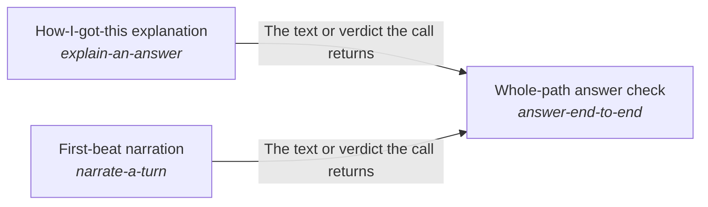

These are ESOI records rendered as a diagram (evolvable structure that optimizes intent). This page is generated from the solutions' outputs and the implementations' `uses_solution_ids` by `esoi diagram`; edit those records, not this page.

# Solution diagram: Mind

Mind lets one step of a request build on the steps before it, and its rebuilt_per_step arm is made of the parts of one step. Budgeted prompt assembler writes the prompt a step sends within a size budget. Cost-ordered model tier selector with outage and allowance recovery picks the model tier a step starts on. Grounded chat turn handler turns the step's decision into the reply to a chat message. First-beat narration writes the first line a person reads while the turn works. How-I-got-this explanation writes, when the person asks for it, how the answer was reached, once the answer is out. Learned-operation fast path answers a request that worked before by replaying its known steps. Core ML tasks classifies the message a step is about. Whole-path answer check proves that a message is handled right across the whole path, with the first line that First-beat narration writes in it. It also proves the account of how the answer was reached, which How-I-got-this explanation writes on request. Reply in steps when the goal is not met yet decides when a turn that is not finished sends an interim message and what that message holds. Show the AI's work and next steps lays out the trail of the work a turn did. Mode-aware progress surfacing streams each event at the level the person wants.

An arrow runs from the solution that provides to the solution that builds on it; its label is what the provider outputs.

