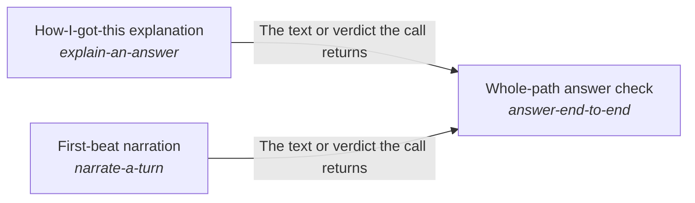

# First-beat narration

*ESOI records kept beside the code in `quest_ai_runner/the_intelligence/mind/response_writer`, generated from the CSV files in this folder by `esoi readmes`. Edit the CSV files, not this page.*

Every request is answered from everything its work has established so far, in the best way possible.

These are the solutions of [Mind](../README.md).

## How the solutions fit together

Mind lets one step of a request build on the steps before it, and its rebuilt_per_step arm is made of the parts of one step. Budgeted prompt assembler writes the prompt a step sends within a size budget. Cost-ordered model tier selector with outage and allowance recovery picks the model tier a step starts on. Grounded chat turn handler turns the step's decision into the reply to a chat message. First-beat narration writes the first line a person reads while the turn works. How-I-got-this explanation writes, when the person asks for it, how the answer was reached, once the answer is out. Learned-operation fast path answers a request that worked before by replaying its known steps. Core ML tasks classifies the message a step is about. Whole-path answer check proves that a message is handled right across the whole path, with the first line that First-beat narration writes in it. It also proves the account of how the answer was reached, which How-I-got-this explanation writes on request. Reply in steps when the goal is not met yet decides when a turn that is not finished sends an interim message and what that message holds. Show the AI's work and next steps lays out the trail of the work a turn did. Mode-aware progress surfacing streams each event at the level the person wants.

## Overview diagram

An arrow runs from the solution that provides to the solution that builds on it; its label is what the provider outputs.

## First-beat narration (`narrate-a-turn`)

Gives a person the one line a person reads while a turn is still working at a cost and delay that its metric accepts.

- Entry call: no entry declared
- Selected implementation: One cheap model call per turn writes the beat (today) (`model_beat`)
- Metric: Supported first beats within the time and cost the turn allows
- Implemented by: [`quest_ai_runner/the_intelligence/critical_thinking/goal_completion/__init__.py`](../../critical_thinking/goal_completion/__init__.py), [`quest_ai_runner/the_intelligence/critical_thinking/goal_completion/orchestrator_judges.py`](../../critical_thinking/goal_completion/orchestrator_judges.py), [`quest_ai_runner/the_intelligence/mind/__init__.py`](../__init__.py), [`quest_ai_runner/the_intelligence/mind/area_mind.py`](../area_mind.py), [`quest_ai_runner/the_intelligence/mind/context_intake/__init__.py`](../context_intake/__init__.py), [`quest_ai_runner/the_intelligence/mind/context_intake/attachments.py`](../context_intake/attachments.py), [`quest_ai_runner/the_intelligence/mind/context_intake/context_doctrine.py`](../context_intake/context_doctrine.py), [`quest_ai_runner/the_intelligence/mind/context_intake/orchestrator_events.py`](../context_intake/orchestrator_events.py) and 72 more

## Implementations

| Implementation | Handle | Code | Selected |
|---|---|---|---|
| One cheap model call per turn writes the beat (today) | `narrate-a-turn:model_beat` | [`quest_ai_runner/the_intelligence/mind/response_writer/orchestrator_turn.py`](orchestrator_turn.py) | selected |
| The Trail (live line, one summary line, expandable groups) | `show-the-ais-work:trail` | [`quest_ai_runner/the_intelligence/mind/response_writer/work_trace.py`](work_trace.py) | selected |
| The structural gate of core/interim_policy.py | `reply-in-steps:gated` | [`quest_ai_runner/the_intelligence/mind/response_writer/interim_policy.py`](interim_policy.py) | selected |

## Metrics

- Supported first beats within the time and cost the turn allows (`metric-narrate-a-turn`): leader `model_beat`, 12 of 13 cases

## Where to go next

- Up: [quest_ai_runner/the_intelligence](../../README.md)
- Intent: [Mind](../README.md)
- Repository: [top README](../../../../README.md)
