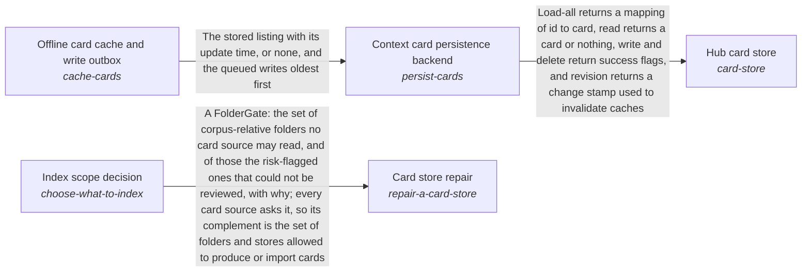

# QAR topic cards for a folder

*ESOI records kept beside the code in `quest_ai_runner/the_intelligence/subconscious/cards_from_files`, generated from the CSV files in this folder by `esoi readmes`. Edit the CSV files, not this page.*

The AI optimally recalls the part of the person's own knowledge that each request needs.

These are the solutions of [Subconscious](../README.md).

## How the solutions fit together

Subconscious recalls the cards that match a request through Hub card store. Hub card store keeps the cards through Context card persistence backend, and Context card persistence backend serves the last known listing while a backend is down with Offline card cache and write outbox. Card store repair decides which sources deserve a card by asking Index scope decision before it rewrites anything. The remaining parts of the area do not use one another in code, so they are grouped here by purpose, the care of a card store that stays current, proportionate and findable. Source-change staleness detector reports the cards that have drifted from their source file. Card store growth prevention keeps a store proportionate to its sources. Card categories and metadata gives each card its labels. QAR topic cards for a folder proposes the topic cards a lane indexes. Context choice chooses what a planner reads before it plans, and the context retriever area describes it in full.

## Overview diagram

An arrow runs from the solution that provides to the solution that builds on it; its label is what the provider outputs.

## QAR topic cards for a folder (`cards-from-files`)

Gives QAR's card store topic cards that group what several files say about one subject, which is what a card is for; a card per file would only be an index of files.

- Entry call: `quest_ai_runner.run("cards-from-files", {'root': '.', 'files': [], 'existing': {}})`
- Selected implementation: QAR topic bootstrap (`qar_topic_bootstrap`)
- Metric: Cards per source-file group after repeated passes, for the guards that prevent growth
- Implemented by: [`quest_ai_runner/the_body/configuration/__init__.py`](../../../the_body/configuration/__init__.py), [`quest_ai_runner/the_body/configuration/acp_deep_runner_config.py`](../../../the_body/configuration/acp_deep_runner_config.py), [`quest_ai_runner/the_body/configuration/card_store_settings.py`](../../../the_body/configuration/card_store_settings.py), [`quest_ai_runner/the_body/configuration/cli_config.py`](../../../the_body/configuration/cli_config.py), [`quest_ai_runner/the_body/configuration/config.py`](../../../the_body/configuration/config.py), [`quest_ai_runner/the_body/configuration/config_assembler.py`](../../../the_body/configuration/config_assembler.py), [`quest_ai_runner/the_body/configuration/config_context_index.py`](../../../the_body/configuration/config_context_index.py), [`quest_ai_runner/the_body/configuration/config_core_settings.py`](../../../the_body/configuration/config_core_settings.py) and 69 more

## Implementations

| Implementation | Handle | Code | Selected |
|---|---|---|---|
| Fast-tier model writes metadata and categories (today) | `label-context-cards:fast_model_labels` | [`quest_ai_runner/the_intelligence/subconscious/cards_from_files/card_metadata_generator.py`](card_metadata_generator.py) | selected |
| QAR topic bootstrap | `cards-from-files:qar_topic_bootstrap` | [`quest_ai_runner/the_intelligence/subconscious/cards_from_files/qar_topic_bootstrap.py`](qar_topic_bootstrap.py) | selected |

## Where to go next

- Up: [quest_ai_runner/the_intelligence](../../README.md)
- Intent: [Subconscious](../README.md)
- Repository: [top README](../../../../README.md)
