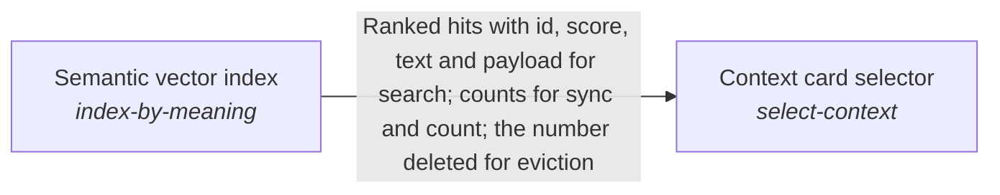

# Selecting the context a planner reads

The planner reads the material the request concerns, however the request is worded.

*ESOI records of this intent (evolvable structure that optimizes intent), generated from the CSV files beside this page by `esoi readmes`. Edit the CSV files, not this page.*

This sub-intent arises as the implementation `choose-the-context:per_lane_assembly` of its parent intent [`subconscious`](../README.md). Opportunities: Which material a planner reads is a retrieval problem with its own alternatives and its own public evidence, which the parent solution does not weigh: lexical, vector and hybrid rankers over a person's cards, files and conversations, a ranker per representative, references that must resolve to current text without failing a turn, and one ranking that holds the cards and the specification records of a repository together so a run also sees when no solution covers its request. Public benchmarks of similar rankers are shown beside the measurements made here.

## How the solutions fit together

Context card selector chooses the cards, files and conversations a planner reads before it plans, so the right material is found however a request is worded. This area arises from the per_lane_assembly arm of Context choice, which takes Context card selector, Fail-safe card reference resolver, Unified card and specification search and Semantic vector index as typed seats, and the lane's configuration chooses which assembler runs. The Semantic vector index finds a card by what it means, not by its words. Fail-safe card reference resolver follows the pointer of a card to the person's current notes and files. Unified card and specification search ranks the cards of a run together with the specification records of a repository in one list.

## Diagram

An arrow runs from the solution that provides to the solution that builds on it; its label is what the provider outputs.

## Solutions at a glance

| Solution | Handle | Entry call | Selected implementation | Metric |
|---|---|---|---|---|
| Context card selector | `select-context` | `quest_ai_runner.run("select-context", 'What should I work on first this week?')` | Blind text search (`blind_grep`) | Context selection ranking accuracy and card-quality outcome |
| Fail-safe card reference resolver | `resolve-references` | no entry declared | Registry of built-in and host resolvers (`note`) | Pointer-resolution safety over offline cases |
| Unified card and specification search | `search-cards-and-specs` | no entry declared | Cards, solutions and problems ranked; intents, ideals and metrics reached through links (`solutions_and_problems_with_links`) | Mixed card and specification selection, with both existing selection metrics held |
| Semantic vector index | `index-by-meaning` | no entry declared | Qdrant-backed vector store (`qdrant`) | Semantic recall and query latency on the synthetic handbook |

## Metrics and their leaders

- Context selection ranking accuracy and card-quality outcome (`metric-select-context`): leader `hub_feature_rerank`, 115 of 185 cases
- Pointer-resolution safety over offline cases (`metric-resolve-references`): leader `card_resolvers`, 16 of 16 cases
- Mixed card and specification selection, with both existing selection metrics held (`metric-search-cards-and-specs`): leader `solutions_and_problems_with_links`, 14 of 17 cases
- Semantic recall and query latency on the synthetic handbook (`metric-index-by-meaning`): leader `memory_cosine`, 16 of 17 cases

## Where to go next

- Parent intent: [Subconscious](../README.md)
- Repository: [top README](../../../../README.md)
- Records: [intent.csv](intent.csv), [solutions.csv](solutions.csv), [implementations.csv](implementations.csv), [metrics.csv](metrics.csv)
- Diagram page: [diagram.md](diagram.md)

---

## The full record

### Solutions

| Solution | Handle | Selected | Metric |
|---|---|---|---|
| Context card selector | `select-context` | Blind text search (`blind_grep`) | Context selection ranking accuracy and card-quality outcome |
| Fail-safe card reference resolver | `resolve-references` | Registry of built-in and host resolvers (`note`) | Pointer-resolution safety over offline cases |
| Unified card and specification search | `search-cards-and-specs` | Cards, solutions and problems ranked; intents, ideals and metrics reached through links (`solutions_and_problems_with_links`) | Mixed card and specification selection, with both existing selection metrics held |
| Semantic vector index | `index-by-meaning` | Qdrant-backed vector store (`qdrant`) | Semantic recall and query latency on the synthetic handbook |

### Implementations

| Implementation | Handle | Where | Sub-intent |
|---|---|---|---|
| Field-weighted keyword arm | `select-context:idf_docstrings` | [evaluation/components/context_selection/impls/idf_docstrings.py](../../../../evaluation/components/context_selection/impls/idf_docstrings.py) |  |
| Docstring ablation of the keyword arm | `select-context:idf_paths_only` | [evaluation/components/context_selection/impls/idf_paths_only.py](../../../../evaluation/components/context_selection/impls/idf_paths_only.py) |  |
| Blind text search | `select-context:blind_grep` | [quest_ai_runner/the_intelligence/subconscious/context_retriever/retrieval_assembler.py](retrieval_assembler.py) |  |
| Plain cosine semantic baseline | `select-context:vector_bge_small` | [evaluation/components/context_selection/impls/vector_bge_small.py](../../../../evaluation/components/context_selection/impls/vector_bge_small.py) |  |
| Keyword plus vector fusion (measured live class) | `select-context:hybrid_union` | [evaluation/components/context_selection/impls/hybrid_union.py](../../../../evaluation/components/context_selection/impls/hybrid_union.py) |  |
| Card-file keyword store | `select-context:file` | [quest_ai_runner/the_body/internal_context/card_store/file_context_store.py](../../../the_body/internal_context/card_store/file_context_store.py) |  |
| Semantic card retrieval | `select-context:vector` | [quest_ai_runner/the_intelligence/subconscious/context_retriever/vector_context_assembler.py](vector_context_assembler.py) |  |
| Parallel keyword and vector fusion | `select-context:hybrid` | [quest_ai_runner/the_intelligence/subconscious/context_retriever/hybrid_context_assembler.py](hybrid_context_assembler.py) |  |
| Exact-content BM25 arm | `select-context:bm25` | [quest_ai_runner/the_intelligence/subconscious/context_retriever/bm25_content_store.py](bm25_content_store.py) |  |
| Per-agent preference wrapper | `select-context:rep` | [quest_ai_runner/the_intelligence/subconscious/context_retriever/rep_context_assembler.py](rep_context_assembler.py) |  |
| Ordered assembler composition | `select-context:composite` | [quest_ai_runner/the_body/configuration/config_assembler.py](../../../the_body/configuration/config_assembler.py) |  |
| Seeded keyword card-quality arm | `select-context:seeded_keyword_store` | [evaluation/components/card_quality/impls/seeded_keyword_store.py](../../../../evaluation/components/card_quality/impls/seeded_keyword_store.py) |  |
| Open-gate ablation of the card-quality arm | `select-context:seeded_keyword_open` | [evaluation/components/card_quality/impls/seeded_keyword_open.py](../../../../evaluation/components/card_quality/impls/seeded_keyword_open.py) |  |
| Live learner plus hybrid store arm | `select-context:live_updater_hybrid` | [evaluation/components/card_quality/impls/live_updater_hybrid.py](../../../../evaluation/components/card_quality/impls/live_updater_hybrid.py) |  |
| Offline warm-hint builder | `select-context:idf_hint` | [evaluation/components/claude_code_ab/impls/idf_hint.py](../../../../evaluation/components/claude_code_ab/impls/idf_hint.py) |  |
| Agent without hint | `select-context:cold_claude` | [evaluation/components/claude_code_ab/impls/cold_claude.py](../../../../evaluation/components/claude_code_ab/impls/cold_claude.py) |  |
| Agent with hint | `select-context:warm_claude` | [evaluation/components/claude_code_ab/impls/warm_claude.py](../../../../evaluation/components/claude_code_ab/impls/warm_claude.py) |  |
| Registry of built-in and host resolvers | `resolve-references:note` | [quest_ai_runner/the_body/configuration/config_assembler.py](../../../the_body/configuration/config_assembler.py) |  |
| Production registry under scripted host resolvers | `resolve-references:card_resolvers` | [evaluation/components/resolve_references/impls/card_resolvers.py](../../../../evaluation/components/resolve_references/impls/card_resolvers.py) |  |
| Two pipelines side by side (today) | `search-cards-and-specs:two_pipelines` | [quest_ai_runner/the_intelligence/subconscious/context_retriever/unified_search.py](unified_search.py) |  |
| Every record kind ranked beside cards (planned) | `search-cards-and-specs:every_record_a_view` |  |  |
| Cards, solutions and problems ranked; intents, ideals and metrics reached through links | `search-cards-and-specs:solutions_and_problems_with_links` | [quest_ai_runner/the_intelligence/subconscious/context_retriever/unified_search.py](unified_search.py) |  |
| The hub's per-file card arm | `select-context:hub_per_file_symbols` | [evaluation/components/context_selection/impls/hub_per_file_symbols.py](../../../../evaluation/components/context_selection/impls/hub_per_file_symbols.py) |  |
| One card per folder, from the hub's card helpers | `select-context:hub_folder_cards` | [evaluation/components/context_selection/impls/hub_folder_cards.py](../../../../evaluation/components/context_selection/impls/hub_folder_cards.py) |  |
| Qdrant-backed vector store | `index-by-meaning:qdrant` | [quest_ai_runner/the_body/internal_context/card_store/qdrant_vector_store.py](../../../the_body/internal_context/card_store/qdrant_vector_store.py) |  |
| BM25 over unit bodies (hub) | `select-context:hub_bm25_body` | [evaluation/components/context_selection/impls/hub_bm25_body.py](../../../../evaluation/components/context_selection/impls/hub_bm25_body.py) |  |
| Fielded BM25 over title, path and body (hub) | `select-context:hub_bm25_fielded` | [evaluation/components/context_selection/impls/hub_bm25_fielded.py](../../../../evaluation/components/context_selection/impls/hub_bm25_fielded.py) |  |
| BM25 over whole files (hub) | `select-context:hub_bm25_whole_files` | [evaluation/components/context_selection/impls/hub_bm25_whole_files.py](../../../../evaluation/components/context_selection/impls/hub_bm25_whole_files.py) |  |
| Dense retrieval with the local bge-small embedder (hub) | `select-context:hub_dense_bge_small` | [evaluation/components/context_selection/impls/hub_dense_bge_small.py](../../../../evaluation/components/context_selection/impls/hub_dense_bge_small.py) |  |
| Latent semantic indexing (hub) | `select-context:hub_lsi` | [evaluation/components/context_selection/impls/hub_lsi.py](../../../../evaluation/components/context_selection/impls/hub_lsi.py) |  |
| BM25 and dense fused by reciprocal rank (hub) | `select-context:hub_hybrid_rrf` | [evaluation/components/context_selection/impls/hub_hybrid_rrf.py](../../../../evaluation/components/context_selection/impls/hub_hybrid_rrf.py) |  |
| Hybrid reranked by weighted features and priors (hub) | `select-context:hub_feature_rerank` | [quest_ai_runner/the_intelligence/subconscious/context_retriever/retrieval_assembler.py](retrieval_assembler.py) |  |
| Feature rerank without link and co-change priors (hub) | `select-context:hub_feature_rerank_no_priors` | [evaluation/components/context_selection/impls/hub_feature_rerank_no_priors.py](../../../../evaluation/components/context_selection/impls/hub_feature_rerank_no_priors.py) |  |
| Hybrid that returns nothing when the corpus does not answer (hub) | `select-context:hub_abstaining_hybrid` | [evaluation/components/context_selection/impls/hub_abstaining_hybrid.py](../../../../evaluation/components/context_selection/impls/hub_abstaining_hybrid.py) |  |
| Hybrid reranked by a model trained on past commits (repository) or on earlier private cases (hub) | `select-context:hub_learned_rerank` | [evaluation/components/context_selection/impls/hub_learned_rerank.py](../../../../evaluation/components/context_selection/impls/hub_learned_rerank.py) |  |
| Learned reranker that returns nothing when the corpus does not answer (hub) | `select-context:hub_abstaining_learned` | [evaluation/components/context_selection/impls/hub_abstaining_learned.py](../../../../evaluation/components/context_selection/impls/hub_abstaining_learned.py) |  |

### Metrics

- Context selection ranking accuracy and card-quality outcome (`metric-select-context`): `esoi run context_selection --impl hybrid_union; esoi run card_quality --impl seeded_keyword_store; esoi run claude_code_ab --impl idf_hint`
- Pointer-resolution safety over offline cases (`metric-resolve-references`): `esoi run resolve_references --impl card_resolvers`
- Mixed card and specification selection, with both existing selection metrics held (`metric-search-cards-and-specs`): `esoi run context_and_specs --impl solutions_and_problems_with_links; esoi run spec_selection --impl solutions_and_problems_with_links; esoi run context_selection --impl solutions_and_problems_with_links`
- Semantic recall and query latency on the synthetic handbook (`metric-index-by-meaning`): `esoi run vector_recall --impl qdrant_embedded`
