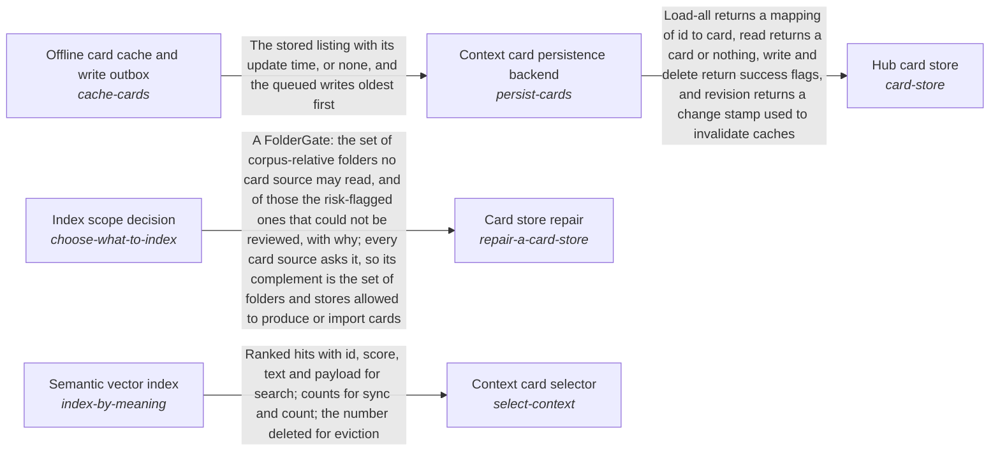
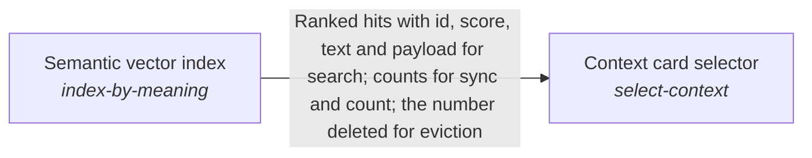

# context_retriever

*ESOI records kept beside the code in `quest_ai_runner/the_intelligence/subconscious/context_retriever`, generated from the CSV files in this folder by `esoi readmes`. Edit the CSV files, not this page.*

A request recalls the part of the person's own knowledge its goal needs, from cards that are current with their sources, found by meaning and proportionate in size, and never from anyone else's.

These are the solutions of [Subconscious](../README.md).

## How the solutions fit together

Subconscious recalls the cards that match a request through Hub card store. Hub card store keeps the cards through Context card persistence backend, and Context card persistence backend serves the last known listing while a backend is down with Offline card cache and write outbox. Card store repair decides which sources deserve a card by asking Index scope decision before it rewrites anything. The remaining parts of the area do not use one another in code, so they are grouped here by purpose, the care of a card store that stays current, proportionate and findable. Source-change staleness detector reports the cards that have drifted from their source file. Card store growth prevention keeps a store proportionate to its sources. Card categories and metadata gives each card its labels. QAR topic cards for a folder proposes the topic cards a lane indexes.

## Overview diagram

An arrow runs from the solution that provides to the solution that builds on it; its label is what the provider outputs.

## Context card selector (`select-context`)

Choose which stored cards, files and conversations a planner reads before it plans, so the right material is found however the request is worded.

- Entry call: no entry declared
- Selected implementation: Blind text search (`blind_grep`)
- Metric: Context selection ranking accuracy and card-quality outcome
- Implemented by: [`evaluation/components/card_quality/impls/live_updater_hybrid.py`](../../../../evaluation/components/card_quality/impls/live_updater_hybrid.py), [`evaluation/components/card_quality/impls/seeded_keyword_open.py`](../../../../evaluation/components/card_quality/impls/seeded_keyword_open.py), [`evaluation/components/card_quality/impls/seeded_keyword_store.py`](../../../../evaluation/components/card_quality/impls/seeded_keyword_store.py), [`evaluation/components/claude_code_ab/impls/cold_claude.py`](../../../../evaluation/components/claude_code_ab/impls/cold_claude.py), [`evaluation/components/claude_code_ab/impls/idf_hint.py`](../../../../evaluation/components/claude_code_ab/impls/idf_hint.py), [`evaluation/components/claude_code_ab/impls/warm_claude.py`](../../../../evaluation/components/claude_code_ab/impls/warm_claude.py), [`evaluation/components/context_selection/impls/hub_abstaining_hybrid.py`](../../../../evaluation/components/context_selection/impls/hub_abstaining_hybrid.py), [`evaluation/components/context_selection/impls/hub_abstaining_learned.py`](../../../../evaluation/components/context_selection/impls/hub_abstaining_learned.py) and 109 more

## Fail-safe card reference resolver (`resolve-references`)

Give the assistant current text from a person's own notes, files and records wherever a card points to them.

- Entry call: no entry declared
- Selected implementation: Registry of built-in and host resolvers (`note`)
- Metric: Pointer-resolution safety over offline cases
- Implemented by: [`evaluation/components/resolve_references/impls/card_resolvers.py`](../../../../evaluation/components/resolve_references/impls/card_resolvers.py), [`quest_ai_runner/the_body/configuration/__init__.py`](../../../the_body/configuration/__init__.py), [`quest_ai_runner/the_body/configuration/acp_deep_runner_config.py`](../../../the_body/configuration/acp_deep_runner_config.py), [`quest_ai_runner/the_body/configuration/card_store_settings.py`](../../../the_body/configuration/card_store_settings.py), [`quest_ai_runner/the_body/configuration/cli_config.py`](../../../the_body/configuration/cli_config.py), [`quest_ai_runner/the_body/configuration/config.py`](../../../the_body/configuration/config.py), [`quest_ai_runner/the_body/configuration/config_assembler.py`](../../../the_body/configuration/config_assembler.py), [`quest_ai_runner/the_body/configuration/config_context_index.py`](../../../the_body/configuration/config_context_index.py) and 71 more

## Unified card and specification search (`search-cards-and-specs`)

Help each run see the cards and specification records it concerns in one ranked set, and see when no solution covers its request yet.

- Entry call: no entry declared
- Selected implementation: Cards, solutions and problems ranked; intents, ideals and metrics reached through links (`solutions_and_problems_with_links`)
- Metric: Mixed card and specification selection, with both existing selection metrics held
- Implemented by: [`quest_ai_runner/the_body/configuration/__init__.py`](../../../the_body/configuration/__init__.py), [`quest_ai_runner/the_body/configuration/acp_deep_runner_config.py`](../../../the_body/configuration/acp_deep_runner_config.py), [`quest_ai_runner/the_body/configuration/card_store_settings.py`](../../../the_body/configuration/card_store_settings.py), [`quest_ai_runner/the_body/configuration/cli_config.py`](../../../the_body/configuration/cli_config.py), [`quest_ai_runner/the_body/configuration/config.py`](../../../the_body/configuration/config.py), [`quest_ai_runner/the_body/configuration/config_assembler.py`](../../../the_body/configuration/config_assembler.py), [`quest_ai_runner/the_body/configuration/config_context_index.py`](../../../the_body/configuration/config_context_index.py), [`quest_ai_runner/the_body/configuration/config_core_settings.py`](../../../the_body/configuration/config_core_settings.py) and 75 more

## Semantic vector index (`index-by-meaning`)

Helps a person or a run find the card or note they need by meaning, including when they ask in different words.

- Entry call: no entry declared
- Selected implementation: Qdrant-backed vector store (`qdrant`)
- Metric: Semantic recall and query latency on the synthetic handbook
- Implemented by: [`quest_ai_runner/the_body/internal_context/card_store/__init__.py`](../../../the_body/internal_context/card_store/__init__.py), [`quest_ai_runner/the_body/internal_context/card_store/card_cache_file.py`](../../../the_body/internal_context/card_store/card_cache_file.py), [`quest_ai_runner/the_body/internal_context/card_store/card_limit_report.py`](../../../the_body/internal_context/card_store/card_limit_report.py), [`quest_ai_runner/the_body/internal_context/card_store/card_store_fence.py`](../../../the_body/internal_context/card_store/card_store_fence.py), [`quest_ai_runner/the_body/internal_context/card_store/card_store_merge.py`](../../../the_body/internal_context/card_store/card_store_merge.py), [`quest_ai_runner/the_body/internal_context/card_store/card_store_migrate.py`](../../../the_body/internal_context/card_store/card_store_migrate.py), [`quest_ai_runner/the_body/internal_context/card_store/card_store_tidy.py`](../../../the_body/internal_context/card_store/card_store_tidy.py), [`quest_ai_runner/the_body/internal_context/card_store/card_store_upload.py`](../../../the_body/internal_context/card_store/card_store_upload.py) and 27 more

## Diagram

An arrow runs from the solution that provides to the solution that builds on it; its label is what the provider outputs.

## Implementations

| Implementation | Handle | Code | Selected |
|---|---|---|---|
| Field-weighted keyword arm | `select-context:idf_docstrings` | [`evaluation/components/context_selection/impls/idf_docstrings.py`](../../../../evaluation/components/context_selection/impls/idf_docstrings.py) |  |
| Docstring ablation of the keyword arm | `select-context:idf_paths_only` | [`evaluation/components/context_selection/impls/idf_paths_only.py`](../../../../evaluation/components/context_selection/impls/idf_paths_only.py) |  |
| Blind text search | `select-context:blind_grep` | [`quest_ai_runner/the_intelligence/subconscious/context_retriever/retrieval_assembler.py`](retrieval_assembler.py) | selected |
| Plain cosine semantic baseline | `select-context:vector_bge_small` | [`evaluation/components/context_selection/impls/vector_bge_small.py`](../../../../evaluation/components/context_selection/impls/vector_bge_small.py) |  |
| Keyword plus vector fusion (measured live class) | `select-context:hybrid_union` | [`evaluation/components/context_selection/impls/hybrid_union.py`](../../../../evaluation/components/context_selection/impls/hybrid_union.py) |  |
| Card-file keyword store | `select-context:file` | [`quest_ai_runner/the_body/internal_context/card_store/file_context_store.py`](../../../the_body/internal_context/card_store/file_context_store.py) |  |
| Semantic card retrieval | `select-context:vector` | [`quest_ai_runner/the_intelligence/subconscious/context_retriever/vector_context_assembler.py`](vector_context_assembler.py) |  |
| Parallel keyword and vector fusion | `select-context:hybrid` | [`quest_ai_runner/the_intelligence/subconscious/context_retriever/hybrid_context_assembler.py`](hybrid_context_assembler.py) |  |
| Exact-content BM25 arm | `select-context:bm25` | [`quest_ai_runner/the_intelligence/subconscious/context_retriever/bm25_content_store.py`](bm25_content_store.py) |  |
| Per-agent preference wrapper | `select-context:rep` | [`quest_ai_runner/the_intelligence/subconscious/context_retriever/rep_context_assembler.py`](rep_context_assembler.py) |  |
| Ordered assembler composition | `select-context:composite` | [`quest_ai_runner/the_body/configuration/config_assembler.py`](../../../the_body/configuration/config_assembler.py) |  |
| Seeded keyword card-quality arm | `select-context:seeded_keyword_store` | [`evaluation/components/card_quality/impls/seeded_keyword_store.py`](../../../../evaluation/components/card_quality/impls/seeded_keyword_store.py) |  |
| Open-gate ablation of the card-quality arm | `select-context:seeded_keyword_open` | [`evaluation/components/card_quality/impls/seeded_keyword_open.py`](../../../../evaluation/components/card_quality/impls/seeded_keyword_open.py) |  |
| Live learner plus hybrid store arm | `select-context:live_updater_hybrid` | [`evaluation/components/card_quality/impls/live_updater_hybrid.py`](../../../../evaluation/components/card_quality/impls/live_updater_hybrid.py) |  |
| Offline warm-hint builder | `select-context:idf_hint` | [`evaluation/components/claude_code_ab/impls/idf_hint.py`](../../../../evaluation/components/claude_code_ab/impls/idf_hint.py) |  |
| Agent without hint | `select-context:cold_claude` | [`evaluation/components/claude_code_ab/impls/cold_claude.py`](../../../../evaluation/components/claude_code_ab/impls/cold_claude.py) |  |
| Agent with hint | `select-context:warm_claude` | [`evaluation/components/claude_code_ab/impls/warm_claude.py`](../../../../evaluation/components/claude_code_ab/impls/warm_claude.py) |  |
| Registry of built-in and host resolvers | `resolve-references:note` | [`quest_ai_runner/the_body/configuration/config_assembler.py`](../../../the_body/configuration/config_assembler.py) | selected |
| Production registry under scripted host resolvers | `resolve-references:card_resolvers` | [`evaluation/components/resolve_references/impls/card_resolvers.py`](../../../../evaluation/components/resolve_references/impls/card_resolvers.py) |  |
| Two pipelines side by side (today) | `search-cards-and-specs:two_pipelines` | [`quest_ai_runner/the_intelligence/subconscious/context_retriever/unified_search.py`](unified_search.py) |  |
| Every record kind ranked beside cards (planned) | `search-cards-and-specs:every_record_a_view` | no code yet |  |
| Cards, solutions and problems ranked; intents, ideals and metrics reached through links | `search-cards-and-specs:solutions_and_problems_with_links` | [`quest_ai_runner/the_intelligence/subconscious/context_retriever/unified_search.py`](unified_search.py) | selected |
| The hub's per-file card arm | `select-context:hub_per_file_symbols` | [`evaluation/components/context_selection/impls/hub_per_file_symbols.py`](../../../../evaluation/components/context_selection/impls/hub_per_file_symbols.py) |  |
| One card per folder, from the hub's card helpers | `select-context:hub_folder_cards` | [`evaluation/components/context_selection/impls/hub_folder_cards.py`](../../../../evaluation/components/context_selection/impls/hub_folder_cards.py) |  |
| Qdrant-backed vector store | `index-by-meaning:qdrant` | [`quest_ai_runner/the_body/internal_context/card_store/qdrant_vector_store.py`](../../../the_body/internal_context/card_store/qdrant_vector_store.py) | selected |
| BM25 over unit bodies (hub) | `select-context:hub_bm25_body` | [`evaluation/components/context_selection/impls/hub_bm25_body.py`](../../../../evaluation/components/context_selection/impls/hub_bm25_body.py) |  |
| Fielded BM25 over title, path and body (hub) | `select-context:hub_bm25_fielded` | [`evaluation/components/context_selection/impls/hub_bm25_fielded.py`](../../../../evaluation/components/context_selection/impls/hub_bm25_fielded.py) |  |
| BM25 over whole files (hub) | `select-context:hub_bm25_whole_files` | [`evaluation/components/context_selection/impls/hub_bm25_whole_files.py`](../../../../evaluation/components/context_selection/impls/hub_bm25_whole_files.py) |  |
| Dense retrieval with the local bge-small embedder (hub) | `select-context:hub_dense_bge_small` | [`evaluation/components/context_selection/impls/hub_dense_bge_small.py`](../../../../evaluation/components/context_selection/impls/hub_dense_bge_small.py) |  |
| Latent semantic indexing (hub) | `select-context:hub_lsi` | [`evaluation/components/context_selection/impls/hub_lsi.py`](../../../../evaluation/components/context_selection/impls/hub_lsi.py) |  |
| BM25 and dense fused by reciprocal rank (hub) | `select-context:hub_hybrid_rrf` | [`evaluation/components/context_selection/impls/hub_hybrid_rrf.py`](../../../../evaluation/components/context_selection/impls/hub_hybrid_rrf.py) |  |
| Hybrid reranked by weighted features and priors (hub) | `select-context:hub_feature_rerank` | [`quest_ai_runner/the_intelligence/subconscious/context_retriever/retrieval_assembler.py`](retrieval_assembler.py) |  |
| Feature rerank without link and co-change priors (hub) | `select-context:hub_feature_rerank_no_priors` | [`evaluation/components/context_selection/impls/hub_feature_rerank_no_priors.py`](../../../../evaluation/components/context_selection/impls/hub_feature_rerank_no_priors.py) |  |
| Hybrid that returns nothing when the corpus does not answer (hub) | `select-context:hub_abstaining_hybrid` | [`evaluation/components/context_selection/impls/hub_abstaining_hybrid.py`](../../../../evaluation/components/context_selection/impls/hub_abstaining_hybrid.py) |  |
| Hybrid reranked by a model trained on past commits (repository) or on earlier private cases (hub) | `select-context:hub_learned_rerank` | [`evaluation/components/context_selection/impls/hub_learned_rerank.py`](../../../../evaluation/components/context_selection/impls/hub_learned_rerank.py) |  |
| Learned reranker that returns nothing when the corpus does not answer (hub) | `select-context:hub_abstaining_learned` | [`evaluation/components/context_selection/impls/hub_abstaining_learned.py`](../../../../evaluation/components/context_selection/impls/hub_abstaining_learned.py) |  |

## Metrics

- Context selection ranking accuracy and card-quality outcome (`metric-select-context`): leader `hub_feature_rerank`, 115 of 185 cases
- Pointer-resolution safety over offline cases (`metric-resolve-references`): leader `card_resolvers`, 16 of 16 cases
- Mixed card and specification selection, with both existing selection metrics held (`metric-search-cards-and-specs`): leader `solutions_and_problems_with_links`, 14 of 17 cases
- Semantic recall and query latency on the synthetic handbook (`metric-index-by-meaning`): leader `memory_cosine`, 16 of 17 cases

## Problems

- An agent asked to answer or work from a person's own material has to find the relevant part of it first. (`prob-context-rediscovered-each-run`)
- A run's context comes from two retrieval pipelines that repeat the same stages separately: context card selection (keyword IDF, vector search, weighted reciprocal-rank fusion, then a cheap-model filter and consolidation) and ESOI record selection (field-weighted TF-IDF, an optional vector search, reciprocal-rank fusion, then a gated cheap-model choice). (`prob-two-searches-for-one-context`)

## Ideals

- Compounding Context (`ideal-compounding-context`): What one run found is kept as a card that later runs reuse, so every run starts grounded in the person's material at little cost, reads only what is current, and can name where each piece came from.
- One Ranked Context (`ideal-one-ranked-context`): A run's context comes from one search over everything it may be grounded in, with one ranking and one budget, and every result says what kind of thing it is and where it lives.

## Where to go next

- Up: [quest_ai_runner/the_intelligence](../../README.md)
- Intent: [Subconscious](../README.md)
- Repository: [top README](../../../../README.md)
