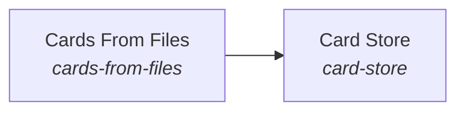

These are ESOI records rendered as a diagram (evolvable structure that optimizes intent). This page is generated from the solutions' outputs and the implementations' `uses_solution_ids` by `esoi diagram`; edit those records, not this page.

# Solution diagram: Subconscious

Subconscious finds and prepares what a request needs before the Mind asks. Cards From Files builds topic cards from a person's own files and history, and Card Store keeps those cards in Quest, so that no card is made for every file.

An arrow runs from the solution that provides to the solution that builds on it; its label is what the provider outputs.

