# Quest Self

*ESOI records kept beside the code in `quest_ai_runner/the_self`, generated from the CSV files in this folder by `esoi readmes`. Edit the CSV files, not this page.*

Goals keep moving between a person's sessions, because the work they delegated gets done to the standard they wrote, and every answer and action rests on the person's own goals, material and preferences, and never on another person's.

These are the solutions of [Grounded AI that advances people's goals](../../esoi/README.md).

## How the solutions fit together

quest-ai-runner turns a person's request or queued task into grounded work in one flow, and the Grounded goal agent is that flow. It takes the request in through Request intake, says what the person is working toward through Higher mind and chooses the context the request needs through Context choice. It reasons step by step through Mind, acts on the account through Body and Quest account access, and answers questions beyond the person's own material through Science. It has every run watched through Nervous System and holds the work to the metric that serves it through Critical Thinking. It asks the model through the Tiered model provider layer and stays comparable by metric through Integrity. It recalls what a request needs through Subconscious. Subconscious recalls the cards that match a request through Hub card store. Tiered model provider layer accounts for every call through Cost estimation, daily budget and host load guard. Mind starts each step on the model tier it picks through Cost-ordered model tier selector with outage and allowance recovery. Nervous System has the model oversee a run through Tiered model provider layer. Queued-task runner claims, runs and reports a queued task, asking the model through Tiered model provider layer and working in the account through Quest account access. It writes each prompt as a registered spec with an owner and a metric through Justified model calls. Body reads and changes the quest through Context card persistence backend, Quest account access and Queued-task runner. Higher mind saves what it learned through Context card persistence backend. Request intake hears from a live channel through Live messaging channel transport. Body changes the quest as the person asks through Quest change executor and writes files inside one folder through Bounded reversible file writer. Body reads from the sources the person's work lives in through Multi-source evidence retriever and hands a new goal to the right owner through Goal assignee and doability judge. Body does heavy work through Bounded autonomous work runner, makes one named change on an outside tool server through Allowlisted operation writer and claims only the reach that World grants. Quest change executor reaches the account through Quest account access and decides through Tiered model provider layer. Goal assignee and doability judge asks the model whether a goal is doable through Tiered model provider layer. World reaches a person through Live messaging channel transport and judges through Tiered model provider layer.

## Overview diagram

An arrow runs from the solution that provides to the solution that builds on it; its label is what the provider outputs.

```mermaid
flowchart LR
    s0["Quest Context<br/><i>quest-context</i>"]
    s1["Quest Requests<br/><i>quest-requests</i>"]
    s2["Quest Body<br/><i>quest-body</i>"]
    s3["Quest Account Truth<br/><i>quest-account-truth</i>"]
    s4["Quest Change Executor<br/><i>quest-change-executor</i>"]
    s5["Quest Intents<br/><i>quest-intents</i>"]
    s6["Quest Self<br/><i>quest-self</i>"]
    s0 -->|"Evidence from the person's own sources, with where each item came from"| s1
    s0 -->|"Evidence from the person's own sources, with where each item came from"| s3
    s1 -->|"The request taken in once and its outcome reported"| s3
    s1 -->|"The request taken in once and its outcome reported"| s6
    s2 --> s1
    s2 --> s3
    s2 --> s4
    s2 --> s6
    s3 -->|"The reply with its account claims checked"| s6
    s4 -->|"The change made and the state read back"| s3
    s5 -->|"The quest the message serves and the intent frame for the work"| s6
```

## Quest Self (`quest-self`)

Make each Quest user meet one whole assistant whose parts agree, so that a part passing its own test cannot hide a failure that the person finds out about.

- Entry call: no entry declared
- Selected implementation: quest-ai-runner library (`library`)
- Metric: Judge pass rate over the chat quality cases, Whole-path turns right on a small mixed set, Quest answers that name the person's goal and circumstance and fit features to them, Day-with-Jarvis turns right end to end, Asks filed and deletes held before anything outward or irreversible happens, Replies that claim only what was done, Passing chat turns per dollar, Delegated tasks meeting their standard, Exact and consented changes, Data kept in scope, Engine reuse, Measured coverage, QAR overall score
- Implemented by: [`evaluation/components/act_as_the_body/__init__.py`](../../evaluation/components/act_as_the_body/__init__.py), [`evaluation/components/act_as_the_body/broken/__init__.py`](../../evaluation/components/act_as_the_body/broken/__init__.py), [`evaluation/components/act_as_the_body/broken/blind_replay.py`](../../evaluation/components/act_as_the_body/broken/blind_replay.py), [`evaluation/components/act_as_the_body/cases.json`](../../evaluation/components/act_as_the_body/cases.json), [`evaluation/components/act_as_the_body/impls/__init__.py`](../../evaluation/components/act_as_the_body/impls/__init__.py), [`evaluation/components/act_as_the_body/impls/card_and_reads.py`](../../evaluation/components/act_as_the_body/impls/card_and_reads.py), [`evaluation/components/act_as_the_body/interface.py`](../../evaluation/components/act_as_the_body/interface.py), [`evaluation/components/act_as_the_body/score.py`](../../evaluation/components/act_as_the_body/score.py) and 1037 more

## Implementations

| Implementation | Handle | Code | Selected |
|---|---|---|---|
| quest-ai-runner library | `quest-self:library` | [`quest_ai_runner/the_self/respond.py`](respond.py) | selected |
| Standing instruction alone (floor) | `critical-thinking:instruction_only` | [`quest_ai_runner/the_self/integrity/prompts/standing_instructions.py`](integrity/prompts/standing_instructions.py) |  |
| Registered prompt specs with an enforcement test (today) | `justify-model-calls:spec_registry` | [`quest_ai_runner/the_self/integrity/prompts/prompt_specs.py`](integrity/prompts/prompt_specs.py) |  |

## Metrics

- Passing chat turns per dollar (`QME1`): leader `reference_replies`, 331 of 331 cases
- Delegated tasks meeting their standard (`QME2`)
- Exact and consented changes (`QME3`)
- Data kept in scope (`QME4`)
- Engine reuse (`QME5`)
- Measured coverage (`QME6`)
- QAR overall score (`metric-qar-overall`): leader `qar_overall.broken.latest_row_any_age:build`, 0 of 9 cases
- Justified share of model spend (`metric-justified-model-spend`): leader `spec_registry`, 15 of 15 cases
- Justified model spend (`QME8`): leader `spec_registry`, 15 of 15 cases
- Cost, budget and resource-guard correctness (`metric-track-usage-and-cost`): leader `qar_usage`, 38 of 39 cases

## Where to go next

- Up: [quest_ai_runner](../README.md)
- Intent: [Grounded AI that advances people's goals](../../esoi/README.md)
- Repository: [top README](../../README.md)
